# Архитектурный стек, среда исполнения и потребление ресурсов

Детальное сравнительное исследование архитектурного фундамента двух медиасерверов: **Airsonic Advanced** (наш форк) и **Navidrome**.

---

## 1. Сравнительная сводка платформ

| Характеристика | Airsonic Advanced (наш форк) | Navidrome (v0.64.2+) |
|---|---|---|
| **Основной язык** | Java 17/21/25 + Kotlin 2.x (активная миграция) | Go 1.22 / 1.23 |
| **Среда исполнения** | Java Virtual Machine (OpenJDK HotSpot / GraalVM) | Нативный скомпилированный ELF/Mach-O/PE бинарник |
| **Веб-сервер / Контейнер** | Встроенный Apache Tomcat 10.1 (Jakarta Servlet 6.0) + Ktor Server 3.x (Servlet-адаптер с переходом на чистый Netty/CIO) | Нативный `net/http` + роутер `go-chi/chi/v5` |
| **Архитектурный каркас** | Spring Boot 3.5.x + Ktor Server (в переходном состоянии) | Стандартная библиотека Go + Google Wire (compile-time DI) |
| **Модель многопоточности** | Пул системных потоков ОС (JVM Threads) + Kotlin Coroutines | Легковесные сопрограммы Go (Goroutines) под управлением планировщика Go (M:N) |
| **Управление зависимостями** | Spring Runtime IoC (рефлексия, аннотации `@Autowired`, `@Service`) $\to$ ручной DI в Ktor | Google Wire (статический Dependency Injection на этапе компиляции, 0% рефлексии) |
| **Формат поставки** | Исполняемый Uber-JAR / WAR-архив (`airsonic.war`), размер ~100–120 МБ | Единый бинарный файл `navidrome` со встроенным UI (`embed.FS`), размер ~40–55 МБ |
| **Внешние системные зависимости** | JRE/JDK (Java 17+), внешний `ffmpeg` | Только `ffmpeg` (при динамической линковке: `libtag`, `libsqlite3`; при статической — 0 зависимостей) |

---

## 2. Потребление системных ресурсов и профиль производительности

### 2.1. Оперативная память (RAM Footprint)

```mermaid
xychart-beta
    title "Потребление оперативной памяти (RSS в мегабайтах)"
    x-axis ["Idle (Простой)", "Активный стриминг (1 клиент)", "Параллельный стриминг (10 клиентов)", "Полное сканирование (100k треков)"]
    y-axis "МБ RAM" 0 --> 3000
    bar [450, 550, 750, 2400]
    bar [45, 60, 95, 280]
```


*(Левый столбец — Airsonic Advanced, правый столбец — Navidrome)*

#### Airsonic Advanced:
- **Базовый простой (Idle):** ~400–600 МБ RSS. Обусловлен структурой JVM: аллокация кучи (Heap), пространство метаданных классов (Metaspace, 80–150 МБ), JIT-компилятор (Code Cache, 50–100 МБ), стеки потоков Tomcat и пулов задач.
- **Активная нагрузка:** 1.5–3.0 ГБ RSS. Сканирование большой библиотеки с помощью Java-библиотеки JAudioTagger приводит к созданию миллионов короткоживущих объектов (`Tag`, `AudioHeader`, `Artwork`), что создает колоссальное давление на Young Generation сборщика мусора (GC). До наступления фазы Full GC память операционной системе практически не возвращается.
- **Ограничения платформы:** Эксплуатация на серверах и платах с оперативной памятью менее 1 ГБ (Raspberry Pi 3/4 1GB, VPS за \$3) крайне затруднена или приводит к аварийным завершениям по OOM (Out Of Memory Killer).

#### Navidrome:
- **Базовый простой (Idle):** **35–65 МБ RSS**. Скомпилированный Go-код не требует виртуальной машины, рантайм Go минимален, а статические структуры занимают минимальный объем памяти.
- **Активная нагрузка:** 150–350 МБ RSS при параллельном обслуживании десятков стримов и фоновом сканировании.
- **Изолированный внешний сканер (`DevExternalScanner`):** Navidrome умеет запускать фазу тяжелого парсинга тегов в отдельном дочернем процессе операционной системы. После завершения сканирования ОС мгновенно забирает всю выделенную память назад на 100%, ликвидируя фрагментацию кучи Go.
- **Ограничения платформы:** Превосходно функционирует на устройствах с 512 МБ RAM (включая Raspberry Pi Zero 2W).

---

### 2.2. Время холодного старта (Cold Start Latency)

1. **Airsonic Advanced:**
   - **Задержка:** от **25 до 60 секунд** (на HDD или медленных процессорах — до 90–120 секунд).
   - **Фазы инициализации:**
     1. Запуск процесса JVM и загрузка базовых классов.
     2. Инициализация Spring Boot ApplicationContext: сканирование сотен компонентов в classpath через рефлексию.
     3. Анализ и выполнение цепочки миграций БД через Liquibase (проверка сотен XML-чейнджсетов в таблице `databasechangelog`).
     4. Запуск встроенного веб-контейнера Tomcat 10, компиляция сервлетов и фильтров.
     5. Инициализация `AirsonicKtorServlet` и прогрев движка маршрутизации Ktor.
     6. Первичный прогрев JIT C2-компилятора JVM.

2. **Navidrome:**
   - **Задержка:** **150 – 400 миллисекунд** (< 0.5 секунды).
   - **Фазы инициализации:**
     1. Мгновенное отображение бинарного файла в память ядром Linux (`mmap`).
     2. Исполнение статического графа инъекций Google Wire (все ссылки связаны на этапе сборки).
     3. Открытие локального файла SQLite в режиме WAL (`journal_mode=WAL`).
     4. Мгновенная проверка схемы базы данных по таблице `migrations` (выполняется за 2–5 мс).
     5. Биндинг TCP-сокета роутера `chi` и запуск приема HTTP-соединений.

---

## 3. Архитектурная декомпозиция и модульность кодовой базы

### 3.1. Структура проекта Airsonic Advanced (Текущий форк)

Кодовая база находится в состоянии **глубокого архитектурного рефакторинга** — перехода от монолитного Spring Boot / JSP стека к реактивному headless-серверу на Kotlin + Ktor:

```
airsonic-advanced-master/
├── pom.xml                               # Корневой Maven-дескриптор
├── subsonic-rest-api/                    # Модуль DTO и контракта REST API
│   ├── pom.xml
│   └── src/main/kotlin/org/subsonic/restapi/  # Чистые Kotlin JAXB DTO (XML/JSON)
├── airsonic-main/                        # Основной модуль сервера
│   ├── pom.xml
│   └── src/main/
│       ├── java/org/airsonic/player/     # Бизнес-логика, DAO, сервисы (Java/Kotlin)
│       │   ├── controller/rest/          # 34 изолированных Ktor REST-контроллера
│       │   │   ├── search/               # SearchController.kt
│       │   │   ├── stream/               # StreamRestController.kt
│       │   │   ├── playlists/            # PlaylistsController.kt, PlaylistImport/Export
│       │   │   ├── admin/                # DLNA, Database, Transcoding, Folders settings
│       │   │   ├── jukebox/              # JukeboxController.kt
│       │   │   └── ...                   # Все методы Subsonic API
│       │   ├── service/                  # MediaFileService, TranscodingService, Scanner
│       │   ├── dao/                      # MediaFileDao, AlbumDao, ArtistDao (Spring JDBC)
│       │   └── spring/                   # AirsonicKtorServlet.kt, KtorConfiguration.java
│       ├── resources/
│       │   ├── liquibase/                # XML-миграции схемы БД (10.6, 11.0)
│       │   └── application.properties    # Spring-конфигурация
│       └── webapp/                       # Устаревший JSP-слой (53 страницы, готовится к удалению)
```

#### Ключевые архитектурные паттерны Airsonic:
- **Переходный мост `AirsonicKtorServlet`:** Запросы к Subsonic REST перехватываются Ktor Servlet Engine внутри Tomcat, конвертируя запросы в асинхронные корутины Ktor.
- **Многоуровневый DAO-слой:** Spring `JdbcTemplate` с явным маппингом строк (`RowMapper`) и генерацией динамического SQL под различные диалекты СУБД (HSQLDB, PostgreSQL, MySQL).
- **Смешанная кодовая база:** Сервисы и вспомогательные утилиты написаны на Java 8–17 с постепенным переносом на Kotlin.
- **Вектор развития:** Полный демонтаж Spring Framework, замена Tomcat на автономный Ktor Netty/CIO Server, вывод JSP и превращение в headless-бэкенд для KMP-клиента (Kord / Youamp).

---

### 3.2. Структура проекта Navidrome

Кодовая база Navidrome спроектирована по канонам **Clean Architecture / Hexagonal Architecture** на чистом Go:

```
navidrome/
├── main.go                               # Точка входа с build-тегами (netgo, sqlite_fts5)
├── cmd/                                  # CLI-команды (Cobra) и DI-провайдеры (Wire)
│   ├── root.go                           # Запуск демона сервера
│   ├── user.go                           # Управление пользователями из консоли
│   ├── scan.go                           # Ручной запуск сканирования
│   ├── wire_gen.go                       # Сгенерированный компилятором граф инъекций
│   └── wire_injectors.go                 # Декларации фабрик зависимостей
├── api/                                  # OpenAPI 3.0 спецификации нативного REST API
├── server/                               # HTTP-транспортный слой
│   ├── subsonic/                         # Полная реализация Subsonic API (роутер Chi)
│   │   ├── api.go                        # Таблица маршрутизации Subsonic
│   │   ├── stream.go                     # Контроллер стриминга и отдачи аудио
│   │   ├── browsing.go                   # Навигация по артистам, альбомам, трекам
│   │   └── responses/                    # Структуры ответов Subsonic (XML/JSON/JSONP)
│   ├── jellyfin/                         # Слой совместимости с API Jellyfin
│   └── public/                           # Публичные эндпоинты (шаринг, обложки)
├── core/                                 # Чистая бизнес-логика (Доменные сервисы)
│   ├── stream/                           # MediaStreamer, кэш транскодирования
│   ├── ffmpeg/                           # Пайплайн запуска и инспекции ffmpeg
│   ├── artwork/                          # Пайплайн обложек (ThumbHash, BlurHash, Dominant)
│   ├── playlists/                        # Менеджер плейлистов и Smart Playlists (NSP)
│   ├── scrobbler/                        # PlayTracker, интеграция с Last.fm / ListenBrainz
│   └── sonic/                            # Интеграция с векторным поиском Sonic
├── model/                                # Доменные сущности и интерфейсы DataStore
│   ├── mediafile.go                      # Модель трека, парсинг аудиосвойств
│   ├── album.go, artist.go               # Модели альбома и артиста
│   └── criteria/                         # AST-движок критериев Smart Playlists
├── db/                                   # Уровень персистентности
│   ├── migrations/                       # Миграции схемы (Go-код + чистый SQL)
│   └── gorm/sql                          # Реализация репозиториев поверх SQLite 3
└── ui/                                   # Встроенный фронтенд (React SPA)
```

#### Ключевые архитектурные паттерны Navidrome:
- **Compile-Time Dependency Injection (Google Wire):** Вся инициализация приложения строго детерминирована на этапе сборки. Никакого сканирования классов или создания прокси-объектов во время исполнения.
- **Строгая инверсия зависимостей:** Сервисы `core` зависят только от интерфейсов `model.DataStore`, не зная деталей реализации SQLite или кэшей.
- **Подсистема плагинов WebAssembly (Extism):** Изолированный безопасный запуск сторонних расширений (метаданные, парсеры) в песочнице WASM с околонулевым оверхедом.

---

## 4. Сравнительная оценка архитектур

> [!NOTE] Архитектурная дилемма
> **Airsonic Advanced** исторически обладал максимальной гибкостью (поддержка любых СУБД от HSQLDB до Oracle/Postgres, десятки типов транскодеров, расширяемость через сервлеты), но платил за это огромным потреблением памяти, медленным запуском и грузом легаси Spring/JSP.
> **Navidrome** изначально проектировался как узкоспециализированная «музыкальная ракета» — монолитный single-binary, жестко оптимизированный под SQLite, с молниеносным стартом и минимальными системными требованиями.

Текущая стратегия нашего форка Airsonic (переход на чистый Ktor, Kotlin Coroutines, отказ от Spring и JSP) методично устраняет главный недостаток Java-стека — тяжеловесность фреймворка, приближая серверную часть по отзывчивости и легковесности к стандартам Navidrome, сохраняя при этом мощь экосистемы JVM.
