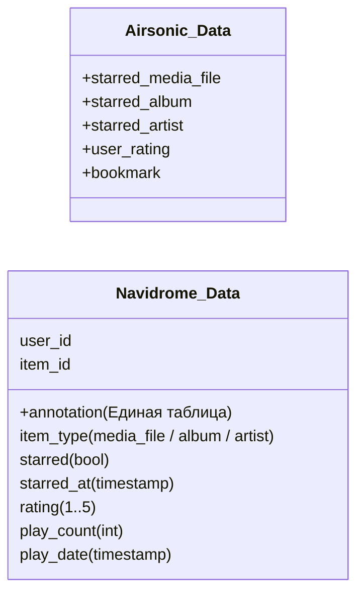

# База данных, схемы хранения и поисковые индексы

Сравнительное исследование слоев персистентности, реляционных схем, стратегий миграций и поисковых движков в **Airsonic Advanced** и **Navidrome**.

---

## 1. Сравнительный анализ СУБД

| Параметр | Airsonic Advanced | Navidrome |
|---|---|---|
| **Поддерживаемые СУБД** | **Мульти-СУБД:** Встроенная HSQLDB 2.5 (по умолчанию), PostgreSQL (12–16), MySQL 8+ / MariaDB 10+ | **Строго одна СУБД:** SQLite 3 (с модулем FTS5) |
| **Драйвер подключения** | JDBC (HikariCP connection pool) | `github.com/mattn/go-sqlite3` (Cgo) |
| **Режим блокировок и concurrency** | Зависит от СУБД (PostgreSQL: MVCC; HSQLDB: page-level/table locks) | SQLite **WAL (Write-Ahead Logging)** + `PRAGMA synchronous=NORMAL` + `busy_timeout=5000` |
| **Сложность развертывания** | Высокая при использовании внешней СУБД (требуется отдельный контейнер/сервис Postgres) | **Нулевая** (всё хранится в единственном файле `navidrome.db`) |
| **Резервное копирование** | `pg_dump`, `mysqldump` или REST API бекап HSQLDB | Горячее онлайн-копирование через SQLite Backup API (`cmd/backup.go`) |
| **Полнотекстовый поиск** | Встроенный **Apache Lucene** (индексные файлы на диске) | Виртуальные таблицы **SQLite FTS5** (полнотекстовый поиск внутри базы) |

---

## 2. Сравнение схем хранения данных

### 2.1. Таблица треков / медиафайлов (`media_file`)

Основная сущность обоих серверов.

| Поле / Атрибут | Реализация в Airsonic (`media_file`) | Реализация в Navidrome (`media_file`) | Архитектурная разница |
|---|---|---|---|
| **Первичный ключ (`id`)** | Автоинкремент `INT` (или путь в старых версиях) | `VARCHAR(255)` детерминированный Persistent ID (PID) | В Navidrome ID не зависит от порядка сканирования и пути на диске. |
| **Путь к файлу (`path`)** | Относительный путь от папки библиотеки (`relative-media-file-paths.xml`) | Относительный или абсолютный путь к файлу | В Airsonic жесткая привязка к `folder_id`. |
| **Артист альбома (`album_artist`)** | Присутствует только в таблице `album` | Отдельные поля: `artist`, `album_artist`, а также `order_artist_name`, `order_album_artist_name` | Navidrome разделяет артиста трека и альбома на уровне каждой записи и строит порядок сортировки. |
| **Многодисковые релизы** | `disc_number INT` | `disc_number INT`, `disc_subtitle VARCHAR` | Navidrome хранит подзаголовок диска. |
| **Аудиофильские параметры** | `bit_rate`, `format`, `duration` | `bit_rate`, `format`, `duration`, `channels`, `sample_rate`, `bpm` | Navidrome сохраняет частоту дискретизации, число каналов и темп трека (BPM). |
| **ReplayGain** | Читается на лету | Сохраняется в схеме: `replay_gain_track_gain`, `replay_gain_album_gain` | Мгновенная отдача ReplayGain без повторного чтения файла. |
| **Тексты песен** | Внешние файлы или чтение из тега | Поле `lyrics TEXT` непосредственно в таблице `media_file` | Navidrome кэширует синхронизированные и простые тексты в базе. |
| **Акцентный цвет обложки** | Отдельная таблица `cover_art` (`accent_color VARCHAR(7)`) | В таблице `artwork` (ThumbHash, BlurHash, Dominant Color) | В Airsonic акцентный цвет `#RRGGBB` сохраняется в таблице обложек. |

---

### 2.2. Хранение пользовательских данных: Избранное, рейтинги и история

Здесь виден принципиально разный подход к нормализации реляционных данных:

#### Airsonic: Денормализованные разрозненные таблицы
- Airsonic заводит отдельную таблицу под каждый тип объекта и действия:
  - `starred_media_file` (пользователь + трек + дата);
  - `starred_album` (пользователь + альбом + дата);
  - `starred_artist` (пользователь + артист + дата);
  - `user_rating` (пользователь + файл + рейтинг 1..5);
  - `bookmark` (пользователь + файл + позиция + комментарий).
- **Следствие:** При генерации списков (например, `getAlbumList2?type=starred` или `search3`) SQL-запросы требуют выполнения множественных `LEFT OUTER JOIN` к 4–5 таблицам, что создает заметную задержку на медленных дисках.

#### Navidrome: Унифицированная таблица аннотаций (`annotation`)
- Navidrome объединяет все действия пользователя в одну компактную таблицу `annotation`:
  - `user_id`, `item_id`, `item_type` (`'media_file'`, `'album'`, `'artist'`), `starred`, `starred_at`, `rating`, `play_count`, `play_date`.
- **Следствие:** Любая выборка («покажи мои любимые альбомы», «топ часто воспроизводимых треков») выполняется простым, сверхбыстрым запросом с использованием составного покрывающего индекса `(user_id, item_type, starred)`.

---

### 2.3. Плейлисты и движок Smart Playlists

| Аспект | Airsonic Advanced | Navidrome |
|---|---|---|
| **Таблицы плейлистов** | `playlist` (метаданные), `playlist_file` (связка M:N с порядковым номером) | `playlist`, `playlist_tracks` |
| **Умные плейлисты (Smart Playlists)** | Не поддерживаются на уровне схемы (только виртуальные генераторы) | Поля в таблице `playlist`: `criteria JSON`, `evaluated_at TIMESTAMP` |
| **Хранение правил Smart Playlist** | — | Дерево предикатов в формате JSON AST (с полями `all`, `any`, `none`, операторами и сортировкой) |

---

## 3. Поисковые движки: Apache Lucene против SQLite FTS5

### 3.1. Airsonic Advanced: Встроенный Apache Lucene
- **Архитектура:** При сканировании медиатеки данные записываются одновременно в базу данных и в отдельный дисковый каталог Lucene-индекса.
- **Плюсы:**
  - Богатые возможности морфологического разбора, стемминга и нечеткого поиска (Fuzzy Search).
- **Минусы:**
  - Риск рассинхронизации: при сбое питания или падении процесса БД может содержать записи, которых нет в Lucene (или наоборот). Требуется регулярное полное перестроение индекса («Re-index search»).
  - Дополнительное потребление дискового пространства и оперативной памяти JVM.

### 3.2. Navidrome: Встроенный SQLite FTS5 (Full-Text Search 5)
- **Архитектура:** Полнотекстовый поиск реализован непосредственно внутри СУБД SQLite через виртуальные таблицы `media_file_fts`, `album_fts`, `artist_fts`.
- **Плюсы:**
  - **100% транзакционная целостность (ACID):** Поисковый индекс обновляется в той же транзакции, что и данные треков. Рассинхронизация физически невозможна.
  - Токенизаторы: поддержка `unicode61` и CJK-символов, покрытие специальными триграмными индексами (`cjk-search-covering-indexes`).
  - Мгновенная работа без выделения дополнительной памяти.

---

## 4. Стратегии и инструменты миграций схемы

### 4.1. Airsonic Advanced: Liquibase
- **Инструмент:** **Liquibase** на базе XML-манифестов (`db-changelog.xml`, каталоги `10.6/`, `11.0/`).
- **Механизм:** При старте сервера Liquibase сверяет выполненные чейнджсеты по таблице `databasechangelog`, блокируя таблицу через `databasechangeloglock`.
- **Плюсы:** Кроссплатформенность DDL-скриптов — один чейнджсет автоматически генерирует диалекты под HSQLDB, PostgreSQL и MySQL.
- **Минусы:** Значительное время исполнения на этапе старта сервера (до 5–15 секунд при сотнях чейнджсетов).

### 4.2. Navidrome: Гибридный Go-SQL мигратор (`db/migrations/`)
- **Инструмент:** Собственный легковесный движок миграций на Go.
- **Механизм:** Файлы миграций упорядочены по меткам времени:
  - `.sql` файлы для стандартных DDL-операций (`CREATE TABLE`, `CREATE INDEX`, `ALTER TABLE`);
  - `.go` файлы для сложных процедурных миграций (например, пересчет всех PID треков, перенос обложек, трансформация JSON-структур).
- **Плюсы:** Проверка актуальности схемы при старте занимает **менее 5 миллисекунд**. Возможность выполнять сложнейшие манипуляции с данными на нативном Go прямо в процессе миграции.
