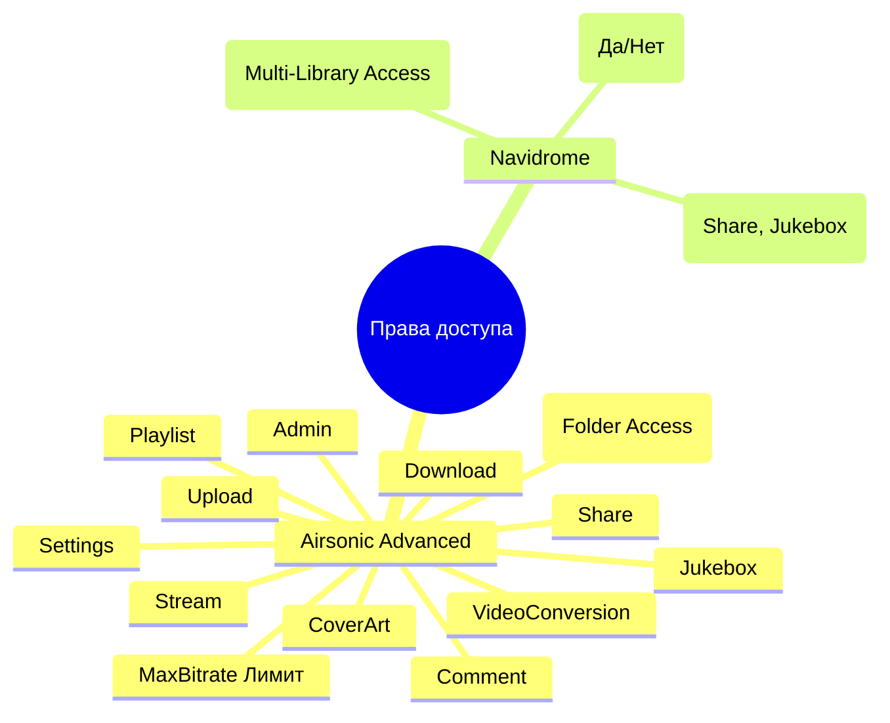

# Безопасность, авторизация и многопользовательский режим

Сравнительный анализ моделей безопасности, механизмов аутентификации, поддержки внешних провайдеров идентичности (SSO/LDAP) и гранулярности прав доступа в **Airsonic Advanced** и **Navidrome**.

---

## 1. Механизмы аутентификации

| Метод аутентификации | Airsonic Advanced | Navidrome |
|---|---|---|
| **Subsonic Token + Salt** | **Поддерживается** (`t=md5(password + salt)`, `s=salt`) | **Поддерживается** (`t=md5(password + salt)`, `s=salt`) |
| **Пароль в открытом виде / Hex (`p=...`)** | **Поддерживается** (открытый пароль и `enc:hex`) | **Поддерживается** (только открытый текст `p`) |
| **Долгоживущие API-ключи (API Keys)** | **Поддерживается** (`CredentialsManagementController.kt`) | **Поддерживается** (OpenSubsonic `apiKeyAuthentication`, префикс `nds_`, сохранение хеша в `player.api_key_hash`) |
| **Веб-аутентификация** | Сессионные куки (`JSESSIONID`) + Spring Security Context | **JWT (JSON Web Tokens)**: подписаны HMAC-SHA256, передаются в заголовке `Authorization: Bearer <token>` |
| **Защита от перебора паролей (Brute-Force)** | Базовые механизмы Spring Security | **Встроенный rate-limiter** (`auth_limiter.go`, библиотека `httprate` с плавающим окном запросов) |

---

## 2. Внешняя аутентификация и Single Sign-On (SSO)

### 2.1. Поддержка LDAP / Active Directory
- **Airsonic Advanced:** **Встроена «из коробки»** (`LdapAuthenticator.java`). Позволяет подключаться напрямую к серверам OpenLDAP, FreeIPA или Microsoft Active Directory. Сервер умеет автоматически создавать локальные учетные записи пользователей при первом успешном входе через LDAP и проверять членство в группах для назначения прав администратора.
- **Navidrome:** **Отсутствует нативная поддержка LDAP**. Разработчики Navidrome сознательно не стали встраивать сложные протоколы каталогов (LDAP/SAML/Kerberos) в бинарник, делегируя эту задачу внешним реверс-прокси.

### 2.2. Reverse Proxy Authentication (Forward Auth)
- **Airsonic Advanced:** Поддерживает аутентификацию по HTTP-заголовкам через `ProxyAuthenticationFilter`. Заголовок пользователя настраивается в параметрах безопасности.
- **Navidrome:** **Глубокая поддержка Forward Auth**. Настраивается через переменные окружения:
  - `ND_REVERSEPROXYUSERHEADER` (например, `Remote-User`, `X-Forwarded-User`);
  - `ND_REVERSEPROXYWHITELIST` (CIDR-диапазоны доверенных прокси, например `127.0.0.1/32, 10.0.0.0/8`).
  - Позволяет бесшовно интегрировать Navidrome с современными провайдерами авторизации: **Authelia**, **Authentik**, **Keycloak**, **Cloudflare Access**, **Tailscale Authentication**.

---

## 3. Гранулярность прав доступа (RBAC) и многопользовательский режим

Здесь проявляется существенная разница в возможностях разграничения прав между двумя проектами:

### 3.1. Airsonic Advanced: Предельная гранулярность ролей
Airsonic обладает одной из самых развитых систем прав среди персональных медиасерверов. Каждому пользователю индивидуально назначаются флаги:
1. `adminRole` — полный доступ к админ-панели и настройкам сервера.
2. `settingsRole` — право изменять собственные персональные настройки и пароль.
3. `streamRole` — право потокового воспроизведения аудио и видео.
4. `downloadRole` — право скачивать исходные медиафайлы на устройство.
5. `uploadRole` — право загружать новые файлы в медиатеку через Web/API.
6. `playlistRole` — право создавать и редактировать плейлисты.
7. `coverArtRole` — право менять и встраивать обложки в альбомы.
8. `commentRole` — право оставлять комментарии к трекам и альбомам.
9. `jukeboxRole` — право управлять выводом звука на звуковой карте сервера.
10. `shareRole` — право генерировать публичные ссылки для внешних пользователей.
11. `videoConversionRole` — право запускать постоянную переконвертацию видео.
12. `maxBitRate` — принудительное ограничение скорости потока (например, ограничить пользователя мобильного тарифа 128 кбит/с).
13. **Ограничение по папкам (Folder-Level RBAC):** Администратор может явно указать, к каким именно каталогам медиатеки (`MusicFolder`) имеет доступ данный пользователь (например, выделить детям доступ только к папке `/Audio/Kids`, скрыв взрослую коллекцию).

### 3.2. Navidrome: Упрощенная модель безопасности
Navidrome ориентирован на простоту администрирования:
- Существует глобальный флаг администратора: `IsAdmin` (`true`/`false`).
- Большинство ролей Subsonic жестко зафиксированы в коде ответа: `uploadRole=false`, `coverArtRole=false`, `commentRole=false`, `podcastRole=false` (так как Navidrome не поддерживает запись тегов и удаление файлов).
- **Многобиблиотечный доступ (Multi-Library Access):** Начиная с недавних версий, Navidrome поддерживает назначение пользователям доступа к конкретным библиотекам (`library_user`), изолируя коллекции треков на уровне корневых путей.
- Управление функциями Jukebox и Sharing регулируется глобальными конфигурационными флагами сервера (`conf.Server.EnableSharing`, `conf.Server.Jukebox.AdminOnly`).
