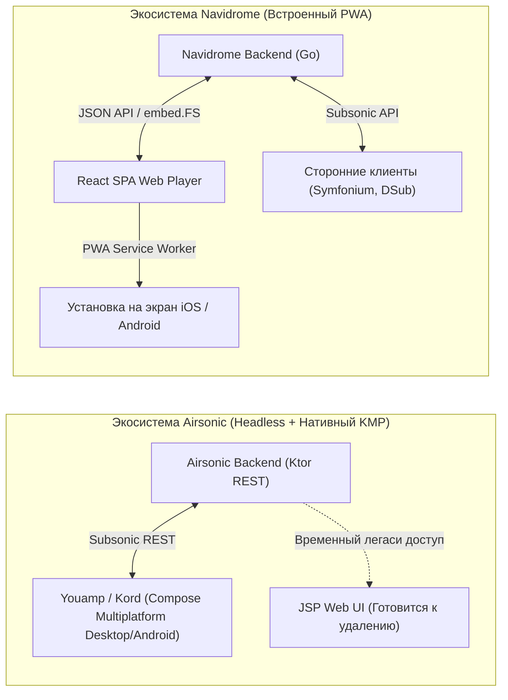

# Веб-интерфейс (UI / UX), мобильный опыт и PWA

Сравнительный анализ пользовательского интерфейса, стека фронтенда, адаптивности и стратегического видения клиентской части в **Airsonic Advanced** и **Navidrome**.

---

## 1. Сравнительная сводка фронтенд-стека

| Характеристика | Airsonic Advanced (наш форк) | Navidrome |
|---|---|---|
| **Архитектура UI** | Серверный рендеринг (SSR) на базе JavaServer Pages (JSP) $\to$ Вывод из эксплуатации | Клиентское одностраничное приложение (Single Page Application, React SPA) |
| **Основной технологический стек** | JSP, JSTL, Apache Jasper, Spring MVC, jQuery, Vanilla JS REST-клиенты | **React 17/18**, **TypeScript**, **Material-UI (MUI)**, **Vite**, React Admin |
| **Сборка и распространение** | Упаковывается в архив WAR/JAR (53 JSP страницы, статические ресурсы) | Собирается через Vite/npm и **встраивается в бинарник Go** через `embed.FS` |
| **Локализация (i18n)** | Java ResourceBundle (30 файлов `.properties`, ~25 000 строк переводов) | Фронтенд-локализация (JSON-словари, десятки поддерживаемых языков) |
| **Стратегический вектор развития** | **Полный демонтаж веб-интерфейса.** Сервер переходит в статус чистого Headless REST-демона для нативного клиента **Youamp / Kord** (Compose Multiplatform). | Постоянное развитие встроенного веб-плеера как флагманского интерфейса Navidrome. |

---

## 2. Пользовательский опыт (UX) и мобильная адаптивность

### 2.1. Airsonic Advanced: Наследие эпохи 2000-х и переход к Headless
- Исторический веб-интерфейс Airsonic разрабатывался более 15 лет назад:
  - Использование HTML-таблиц, серверных форм и тяжелых JSP-тегов.
  - Несмотря на внедрение тем оформления (`ACCENT_COLOR.md`, темные стили) и ликвидацию WebSockets/DWR в пользу чистых Vanilla JS клиентов, веб-интерфейс остается громоздким.
  - На мобильных браузерах навигация по таблицам треков неудобна: мелкие элементы управления, отсутствие поддержки свайпов и жестов.
  - Сервер не поддерживает стандарты Progressive Web App (PWA): отсутствует Service Worker для оффлайн-кэширования страниц и манифест веб-приложения.
- **Стратегическое решение нашего форка:**
  - Поддержание серверного веб-интерфейса признано тупиковым направлением, отнимающим колоссальные ресурсы на верстку и локализацию.
  - Основным интерфейсом становится нативный десктопный и мобильный клиент **Youamp / Kord**, написанный на **Kotlin Multiplatform (KMP) + Compose Multiplatform**. Клиент воспроизводит лучший UX современной стриминговой платформы (экраны «Моя волна», караоке-тексты, плавные анимации эквалайзера, оффлайн-кэш), полностью освобождая бэкенд от необходимости рендерить HTML.

### 2.2. Navidrome: Современный легковесный React SPA
- Веб-интерфейс Navidrome спроектирован с нуля как современный веб-плеер:
  - **Дизайн:** Интерфейс построен на компонентах Material-UI в стиле Spotify / YouTube Music с глубокой темной темой по умолчанию.
  - **Адаптивность (Mobile-First):** Веб-приложение полностью адаптируется под экраны любых диагоналей — от ультрашироких 4K-мониторов до экранов смартфонов. Сайдбар сворачивается в мобильное нижнее навигационное меню (Bottom Navigation Bar).
  - **Поддержка PWA (Progressive Web App):** Веб-плеер регистрирует Service Worker (`workbox-cli`). Пользователь может «установить» Navidrome из браузера Chrome или Safari на домашний экран смартфона как самостоятельное нативное приложение без адресной строки браузера.
  - **Медиаплеер в браузере:** Полнофункциональный аудиобар в нижней части экрана с визуализацией прогресса, регулятором громкости, очередью воспроизведения, интеграцией с системным MediaSession API ОС (отображение обложки и контролов воспроизведения на экране блокировки смартфона или в панели уведомлений).
