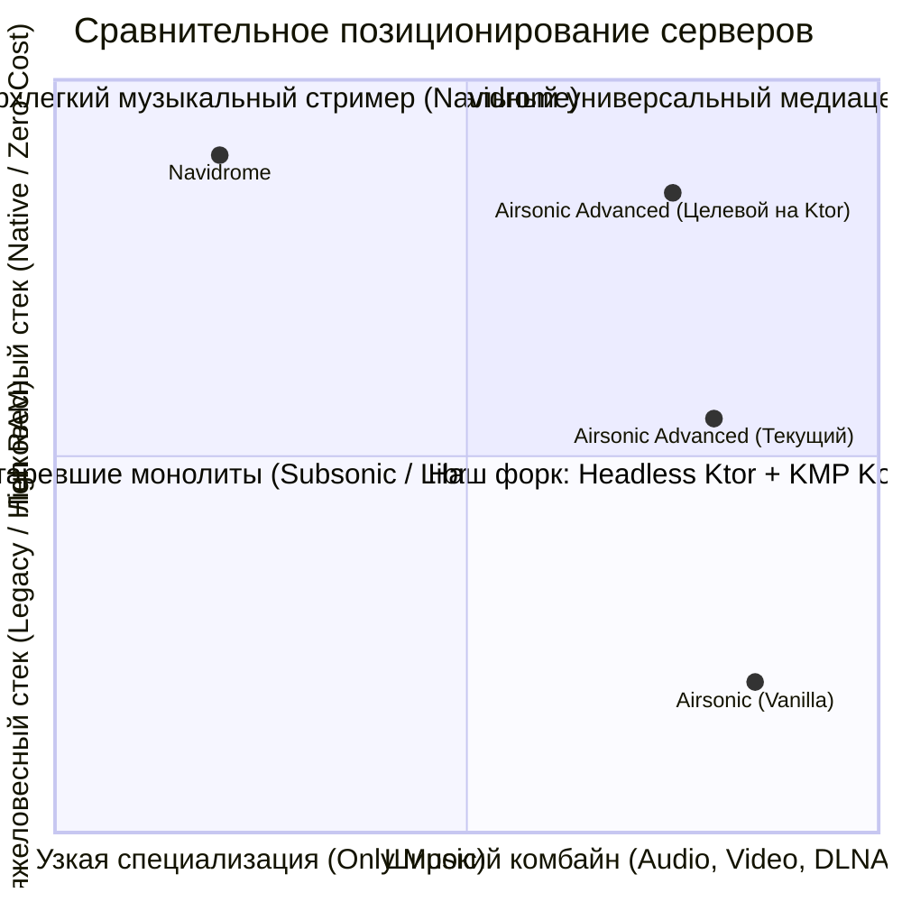

# Итоговые выводы и архитектурные рекомендации для нашего форка

Синтез результатов глубокого сравнительного анализа **Airsonic Advanced** и **Navidrome**. Стратегические ориентиры развития нашего форка, технологические решения, которые имеет смысл перенять у Navidrome, и ключевые конкурентные преимущества нашей платформы.

---

## 1. Сравнительная сводка сильных и слабых сторон (SWOT-анализ)



### 1.1. Airsonic Advanced (Наш форк)
- **Сильные стороны:**
  - Полный спектр управления медиатекой: редактирование тегов на диске, удаление файлов, загрузка треков через Web/API.
  - Встроенный сервер DLNA/UPnP для домашней акустики и Smart TV без сторонних шлюзов.
  - Полноценная поддержка видеоконтента, транскодирования HLS и субтитров.
  - Предельно гранулярная ролевая модель (RBAC) с разграничением прав на уровне конкретных папок медиатеки.
  - Эксклюзивные эндпоинты нашего форка для клиента нового поколения (Kord / Youamp): алгоритмическая «Моя волна» (`/rest/kord/vibe/next`), караоке-тексты LRC (`/rest/kord/lyrics`), система дизлайков (`/rest/kord/dislike`) и акцентные цвета обложек (`accentColor`).
  - Поддержка промышленных СУБД (PostgreSQL, MySQL).
- **Слабые стороны (ликвидируемые в процессе рефакторинга):**
  - Высокое потребление оперативной памяти JVM (400–800 МБ в простое, до 2.5 ГБ при сканировании).
  - Медленный холодный старт (25–60 секунд) из-за наследия Spring Boot и Liquibase.
  - Отсутствие кэширования транскодированных аудиопотоков на диске (повторная нагрузка на FFmpeg).
  - Привязка идентификаторов треков к путям на диске (риск потери лайков и истории при переименовании файлов).

### 1.2. Navidrome
- **Сильные стороны:**
  - Невероятная легковесность: единый бинарный файл, потребление 40–80 МБ RAM, старт за 200–400 мс.
  - Архитектурная надежность: абсолютный Read-Only доступ исключает риск повреждения или случайного удаления коллекции.
  - Мощный движок Smart Playlists (NSP) с богатым AST-языком JSON-запросов.
  - Дисковый LRU-кэш транскодирования (`TranscodingCache`), снижающий нагрузку на CPU при повторных прослушиваниях до 0%.
  - Детерминированные Persistent IDs (PID) — сохранение плейлистов и лайков даже при полном переименовании файлов.
  - Быстрый сканер на C++ TagLib с возможностью запуска в изолированном дочернем процессе (`DevExternalScanner`).
  - Эмуляция API Jellyfin (`/jellyfin`) для подключения клиентов Finamp и Streamyfin.
- **Слабые стороны:**
  - Принципиальный отказ от любого не-музыкального контента (видео возвращает HTTP 410).
  - Невозможность удаленного редактирования тегов или исправления обложек.
  - Отсутствие встроенного DLNA/UPnP (требуются внешние контейнеры).
  - Привязка строго к SQLite 3 (сложность масштабирования в кластерных или высоконагруженных конфигурациях).
  - Упрощенная модель прав (только `IsAdmin` и библиотеки, без папочных ограничений).

---

## 2. Что имеет смысл перенять или портировать в наш форк Airsonic

Изучение инженерных находок Navidrome дает нашему форку четкий список высокоэффективных улучшений:

### 2.1. Внедрение дискового кэша транскодирования (Transcoding Cache)
- **Суть проблемы в Airsonic:** Сейчас каждый вызов `stream` с транскодированием запускает новый `ProcessBuilder(ffmpeg)`. Повторное прослушивание трека или перемотка повторно сжигает процессорное время.
- **Решение:** Реализовать сервис `TranscodeCacheService` (например, на базе `DiskLruCache` или Guava/Caffeine с хранилищем в `airsonic/transcode-cache`). Сохранять результат работы `ffmpeg` под ключом `Hash(file_id + format + bitrate)`. При повторном запросе отдавать готовый файл через асинхронный Ktor `call.respondFile()` с мгновенной поддержкой HTTP 206 Range.

### 2.2. Патчинг заголовков FLAC на лету (`patchFLACDuration`)
- **Суть проблемы в Airsonic:** При транскодировании аудио в формат FLAC через пайп `ffmpeg` выставляет `total_samples = 0`. Мобильные плееры считают поток радиостанцией и отключают перемотку.
- **Решение:** Позаимствовать алгоритм Navidrome (`flac_streaminfo.go`): перехватывать первые 26 байт потока в `TranscodeInputStream`, вычислять точное количество сэмплов по длительности и частоте дискретизации, и бинарно перезаписывать поле `total_samples` прямо в памяти.

### 2.3. Входное позиционирование FFmpeg (`-ss <offset>` перед `-i`)
- **Суть проблемы:** Убедиться, что во всех шаблонах транскодирования флаг смещения `%o` передается **до** входного файла `%s` (`ffmpeg -ss %o -i %s ...`). Это активирует быстрое демультиплексирование ключевых кадров без декодирования всего предыдущего контента.

### 2.4. Переход к детерминированным Persistent IDs (PID)
- **Суть проблемы в Airsonic:** При перемещении трека из одной папки в другую путь меняется, что может приводить к удалению трека из плейлистов и потере истории.
- **Решение:** Добавить в таблицу `media_file` колонку `persistent_id VARCHAR(64)`. При первом сканировании генерировать хеш:
  $$\text{PID} = \text{SHA256}(\text{Artist} + \text{Album} + \text{DiscNumber} + \text{TrackNumber} + \text{Title})$$
  (или использовать MBID трека при наличии). Связывать таблицы `starred_media_file`, `user_rating`, `playlist_file` не с автоинкрементным ID или путем, а с детерминированным `persistent_id`.

### 2.5. Движок Smart Playlists (Умные плейлисты)
- **Суть проблемы:** В Airsonic плейлисты статичны. У пользователей нет возможности создать плейлист «Все рок-треки 80-х с рейтингом 5 звезд, которые я не слушал последний месяц».
- **Решение:** Реализовать парсер критериев в формате JSON AST, совместимый с форматом Navidrome Smart Playlists (`.nsp`). Это позволит пользователям импортировать умные плейлисты из сообщества Navidrome прямо в наш форк.

---

## 3. В каких сценариях наш форк Airsonic объективно превосходит Navidrome

1. **Единый универсальный бэкенд для нативных клиентов нового поколения (Kord / Youamp):**
   - Наш форк является не просто стримером файлов, а «умным бэкендом». Эндпоинты `/rest/kord/vibe/next` генерируют адаптивную волну воспроизведения с анализом музыкального вкуса, языка и настроения, чего Navidrome не предоставляет в принципе.
2. **Полноценный медиаменеджмент (Read-Write):**
   - Пользователь в поездке или с мобильного устройства может исправить теги альбома, обновить обложку или загрузить свежий релиз через REST API.
3. **Бесшовная интеграция с домашней мультимедийной техникой (DLNA/UPnP):**
   - Воспроизведение прямо на телевизорах LG webOS / Samsung Tizen, AV-ресиверах Denon / Yamaha без необходимости установки клиентских приложений на каждое устройство.
4. **Гибридный аудио- и видеостриминг:**
   - Хранение музыкальных клипов, видеоконцертов и подкастов в едином хранилище с адаптивным видео-транскодированием HLS.
5. **Масштабируемость корпоративного уровня:**
   - Возможность работы с внешними кластерами PostgreSQL и интеграция с корпоративными каталогами пользователей LDAP / Active Directory.
6. **Гранулярное разграничение доступа:**
   - Возможность безопасного шеринга сервера с друзьями и членами семьи с жестким папочным изолированием (например, персональные изолированные папки для каждого пользователя).

---

## 4. Резюме дорожной карты (Roadmap)

```text
┌────────────────────────────────────────────────────────────────────────┐
│ 1. Завершение перехода на чистый Ktor + Coroutines (ликвидация Spring) │
├────────────────────────────────────────────────────────────────────────┤
│ 2. Внедрение TranscodingCache (LRU на диске) + Fast Seek (-ss до -i)   │
├────────────────────────────────────────────────────────────────────────┤
│ 3. Внедрение FLAC Duration Patcher (восстановление перемотки FLAC)     │
├────────────────────────────────────────────────────────────────────────┤
│ 4. Внедрение Persistent IDs (PID) для устойчивости метаданных          │
├────────────────────────────────────────────────────────────────────────┤
│ 5. Развитие эксклюзивного API Kord («Моя волна», тексты, персональные) │
└────────────────────────────────────────────────────────────────────────┘
```
Переход на легкий Ktor-стек окончательно стирает единственный фундаментальный недостаток Airsonic (тяжеловесность JVM-контейнеров), сохраняя все уникальные функциональные преимущества медиакомбайна!
